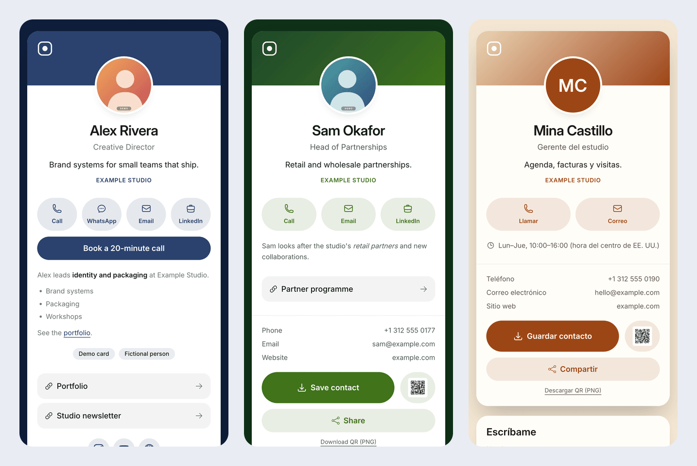

# borda-kit

[](https://github.com/bajalabs/borda-kit/actions/workflows/ci.yml)
[](LICENSE)
[](https://github.com/bajalabs/borda-kit/releases)

A link-in-bio boards template for teams: each person gets a contact card at `boards.<your-domain>/<slug>` with a vCard download, QR codes, a photo, a Markdown bio, social links and an optional lead form, built by [Astro](https://astro.build) from JSON files in the repository into a static site that runs on any static host.



The people, addresses and photos above are a fictional demo that ships with the template.

## Use this template

1. Click **Use this template** on GitHub (or clone this repository) to get your own copy.
2. Replace the demo in `content/` with your sites and boards ([content/README.md](content/README.md)).
3. Put your brand in `src/brand/` and `public/brand/` ([Theming](#theming)).
4. Deploy `dist/` to a static host ([Deploy](#deploy)) with `BORDA_ENV=production`, which refuses demo content and leftovers.

## Quick start

Requires Node.js 24 and pnpm 10 (`corepack enable` gives you the pnpm version pinned in `package.json`).

```sh
pnpm install
pnpm dev      # http://localhost:4335 — the demo, with every change reloaded
pnpm test     # unit tests (vitest)
pnpm build    # content → gates → type check → static site in dist/ → output gates
```

`pnpm preview` serves the built `dist/`.

## What is inside

| Path | What it holds |
|---|---|
| `content/` | The demo: 2 sites (English at `/`, Spanish at `/es`), 3 boards each, 2 generated placeholder photos. [Format](content/README.md). |
| `schema/` | `site.schema.json` and `board.schema.json`, generated from `src/borda/schema.ts` (`pnpm schema`), for editor checks. |
| `src/borda/` | The content loader and schema, vCard 4.0, QR (SVG and PNG), Markdown subset, photo sizing, redirects, contrast. |
| `src/pages/` | The routes: index, card, `contact.vcf`, `qr.svg`, `qr.png`, `og.jpg`, thank-you, 404, `robots.txt`, sitemap, build receipt. |
| `src/components/`, `src/layouts/`, `src/styles/`, `src/i18n/` | The card, the board list, the lead form, the page shell, five themes, English and Spanish copy. |
| `src/brand/`, `public/brand/` | Your brand: colour tokens, fonts, marks, the social card's look, copy overrides. |
| `scripts/` | `borda-load.mjs` (content → `.borda/`), `schema.mjs`, and the three gates. |
| `tests/` | 13 vitest files, 65 tests. |

Each board gets five files: `/<slug>` (the card), `/<slug>/contact.vcf`, `/<slug>/qr.svg`, `/<slug>/qr.png` (1024 px, for print) and `/<slug>/og.jpg` (1200 × 630 social preview with the photo). The demo build writes 13 pages and 30 card files.

## How a build works

`pnpm build` runs, in order, and stops at the first failure:

1. `scripts/borda-load.mjs` reads `content/`, validates every file with Zod, resolves photos, orders boards, and writes `.borda/content.json` and the build receipt `.borda/build.json`.
2. The **content gate** (`scripts/gates/content.mjs`): published boards have an email, no template leftovers (`lorem ipsum`, `TODO`, `example.com` addresses, `555-01xx` numbers) outside a demo site, and with `BORDA_ENV=production` no demo site, no empty site and no lead form posting over plain http.
3. `astro check`, then `astro build` to `dist/`.
4. The **output gate** (`scripts/gates/dist.mjs`): every board has its page, vCard, QR codes and social image; one `<h1>`, `lang`, a canonical URL on the site URL; responsive photos; no secret-looking strings.
5. The **redirect gate** (`scripts/gates/redirects.mjs`): every redirect is in the output.

CI runs lint, type check, tests and two builds (the default, and a base-path build with a `_redirects` file), then a mobile Lighthouse check on the demo (performance at least 95, accessibility 100).

## Settings

Every setting is an environment variable; none is required.

| Variable | Default | What it does |
|---|---|---|
| `BORDA_SITES` | every folder in `content/` with a `site.json` | The sites to build, comma-separated; the first is served at `/`. |
| `BORDA_SITE_URL` | `https://<boards_domain>` of the primary site | The public URL, used for canonical links, QR codes, vCards and social images. A path is a base path: `https://<owner>.github.io/<repo>`. |
| `BORDA_ENV` | unset | `production` turns warnings into failures: demo content, leftovers, an empty site, an http form. |
| `BORDA_DRAFTS` | unset | `1` builds boards with `"status": "draft"` (for previews). |
| `BORDA_NOINDEX` | unset | `1` adds `noindex` to every page and disallows crawling in `robots.txt` (for previews). Demo sites are always `noindex`. |
| `BORDA_REDIRECTS` | `html` | `html`: a small page per redirect, which every static host serves. `file`: a `_redirects` file instead, which Netlify and Cloudflare Pages answer with a real 3xx. |
| `BORDA_ALLOW_EMPTY` | unset | `1` lets a production build publish a site with no published boards. |
| `BORDA_ALLOW_LEFTOVERS` | unset | `1` skips the leftover check (only if your real content needs one of those words). |
| `PORT` | `4335` | The port of `pnpm dev` and `pnpm preview`. |

## Theming

Everything brand-shaped lives in three places, so the rest of the kit can be updated without touching your brand:

- **`src/brand/tokens.css`**: the colour tokens in OKLCH (`--color-brand`, `--color-brand-deep`, `--color-base-*`) and `--font-sans`. The `navy` theme is built from these, so changing them re-colours the default look.
- **`src/brand/index.ts`**: the default theme; the mark on the card's band and the favicon (paths under `public/brand/`); the web fonts the pages declare and preload (`fonts`, files under `public/brand/fonts/`); the social card's gradient, text colour, typeface and mark (`og`; satori needs a TTF, OTF or WOFF file, not WOFF2); and copy overrides per language (`copy`, any key of `src/i18n/index.ts`, for example `{ es: { contact: "Escríbanos" } }`).
- **`public/brand/`**: `logo-white.svg`, `favicon.svg` and the font files.

**Themes.** `src/styles/global.css` defines five: `navy`, `charcoal`, `sand`, `forest` and `ink`. A theme sets the page (`--surface`, `--ink`), the card (`--card`, `--card-ink`, `--card-muted`), the accent (`--accent`) and the text on the accent (`--on-accent`). A site picks one with `theme`, a board may pick its own and set its own `accent`. `tests/themes.test.ts` holds every theme to 4.5:1 contrast for text and buttons, so a change that makes a theme hard to read fails the tests.

**Type and spacing.** Three fluid text steps (`--text-display`, `--text-title`, `--text-lead`) and a spacing scale (`--spacing-gutter`, `--spacing-stack-1` to `-4`) in `global.css`, used as Tailwind classes (`text-display`, `px-gutter`, `mt-stack-3`). The one animation respects `prefers-reduced-motion`.

**Fonts.** The demo ships Inter (SIL Open Font License, `public/brand/fonts/OFL.txt`). To use another: put the files in `public/brand/fonts/`, list the web font in `brand.fonts`, name it first in `--font-sans`, and point `brand.og.fontFile` at a TTF or OTF of it.

**Languages.** English and Spanish copy ship in `src/i18n/index.ts`; a site's `locale` picks one. Add a language by adding a dictionary there.

## Deploy

`pnpm build` writes a plain static site to `dist/`: no server, no adapter, no platform SDK. Every host below runs the same build; set `BORDA_ENV=production` in the production environment.

| Host | Build command | Output | Notes |
|---|---|---|---|
| Vercel | `pnpm build` | `dist` | `vercel.json` sets the build and the response headers. Redirects are pages (`BORDA_REDIRECTS=html`). |
| Netlify | `pnpm build` | `dist` | `public/_headers` sets the headers. Set `BORDA_REDIRECTS=file` for real 3xx redirects. |
| Cloudflare Pages | `pnpm build` | `dist` | Same `_headers`; `BORDA_REDIRECTS=file` for real 3xx redirects. |
| GitHub Pages | see `docs/deploy/github-pages.yml` | `dist` | Copy the workflow to `.github/workflows/`. On a project site, set `BORDA_SITE_URL=https://<owner>.github.io/<repo>`. |
| Any other (S3, a CDN, nginx) | `pnpm build` | `dist` | Upload `dist/`. Serve `*.vcf` as `text/vcard`. |

Point `boards.<your-domain>` at the host with the CNAME record your host gives you, and keep `boards_domain` in `site.json` in step with it (or set `BORDA_SITE_URL`).

## Limitations

- Content changes need a rebuild and a deploy; there is no editor UI and no database. The content is plain JSON in git.
- The lead form needs a backend you provide ([content/README.md](content/README.md#lead-form)); the kit only renders and posts the form.
- English and Spanish copy ship; other languages need a dictionary in `src/i18n/index.ts`.
- On Vercel and GitHub Pages redirects are HTML pages (meta refresh and canonical link), not HTTP 3xx.
- `astro check` runs inside every build, which adds a few seconds.

## Contributing

See [CONTRIBUTING.md](CONTRIBUTING.md). Report security issues privately as described in [SECURITY.md](SECURITY.md).

## License

[MIT](LICENSE) © 2026 Baja Labs. The bundled Inter font files are under the SIL Open Font License 1.1 ([`public/brand/fonts/OFL.txt`](public/brand/fonts/OFL.txt)). Icons in `src/components/Icon.astro`: Heroicons (MIT) and Bootstrap Icons (MIT).

## Citation

If you refer to this project in writing, cite it as: Baja Labs (2026). *borda-kit: a link-in-bio boards template*. https://github.com/bajalabs/borda-kit
